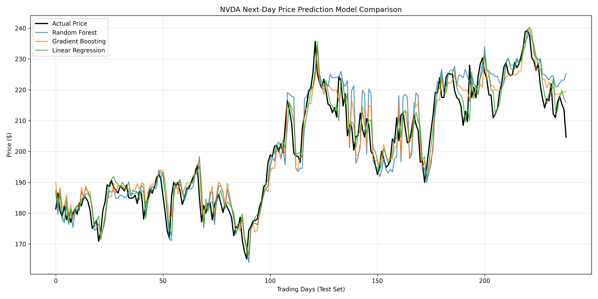

# 📈 Stock Price Prediction Model Comparison (NVDA)

An end-to-end machine learning pipeline that fetches historical daily stock data via the **Alpaca Markets API**, engineers technical indicators, and benchmarks three regression models on next-day closing price prediction.



## 📊 Benchmark Results (Test Set MAE)
| Model | Mean Absolute Error (MAE) |
| :--- | :--- |
| **Linear Regression** | **$3.68** |
| **Gradient Boosting (`HistGradientBoostingRegressor`)** | **$4.59** |
| **Random Forest (`RandomForestRegressor`)** | **$5.21** |

## 🔍 Overview & Methodology
- **Data Source:** Historical daily OHLCV bars for NVIDIA (`NVDA`) via `alpaca-py`.
- **Feature Engineering:** Daily percentage returns, 5-day rolling volatility, and 5-, 10-, and 20-day Simple Moving Averages (SMAs).
- **Validation Strategy:** Strict **80/20 chronological train/test split** to prevent time-series data leakage.

## 🚀 Setup & Usage
1. Clone the repository:
   ```bash
   git clone [https://github.com/MEugene777/stock-price-predictor.git](https://github.com/MEugene777/stock-price-predictor.git)
   cd stock-price-predictor
   ```
2. Install dependencies:
   ```bash
   pip install -r requirements.txt
   ```
3. Copy `.env.example` to `.env` and add your free [Alpaca Markets](https://alpaca.markets/) API keys.
4. Run the pipeline:
   ```bash
   python3 stock_prediction.py
   ```

> **Disclaimer:** *This project is for educational and portfolio demonstration purposes only and does not constitute financial or investment advice.*
